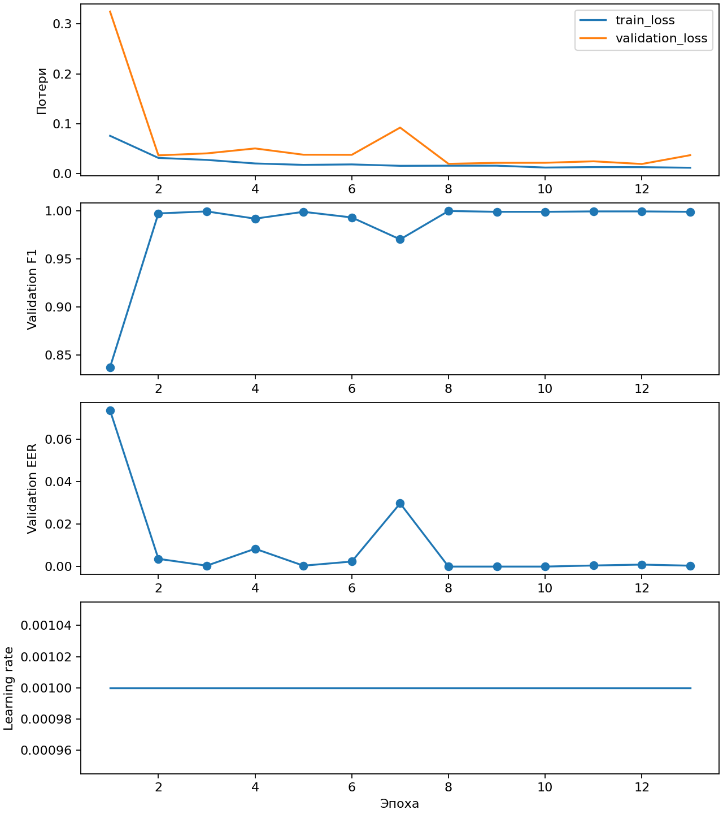
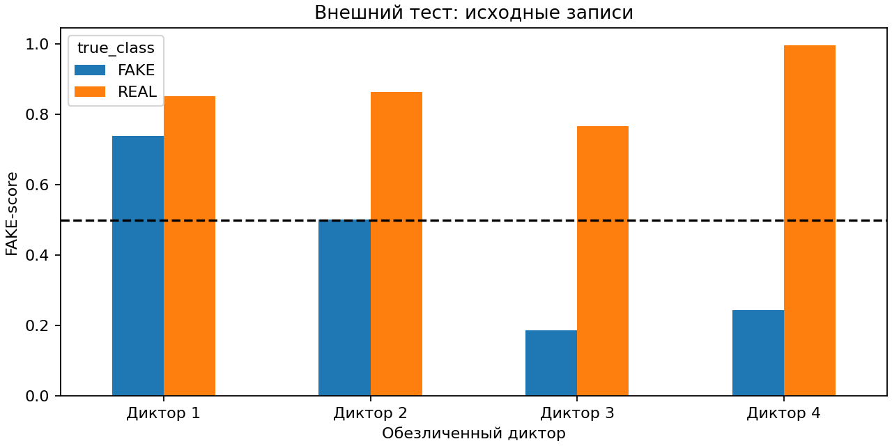

# Журнал экспериментов ВКР

**Тема** — «Анализ аудиофайлов на предмет синтезированной речи».

**Цель** — разработать детектор синтезированной русской речи и измерить его
качество на уровне исходных записей, включая записи от неизвестных при обучении
генераторов. Стек проекта — Python, Google Colab, PyTorch для CNN и PyQt6 для
графического интерфейса. Основной обучающий датасет — RuASD.

## Данные и подготовка

В исходном манифесте 12 806 аудиозаписей. Подготовленный набор содержит 38 017
четырёхсекундных FLAC при 32 кГц. Подготовка включает преобразование в моно,
ресемплинг и дополнение последнего неполного сегмента нулями. Для 321 записи
с `duration = -1` фактическая длительность определялась при декодировании.

| Split | REAL-фрагменты | FAKE-фрагменты |
|---|---:|---:|
| Train | 8164 | 18186 |
| Validation | 1989 | 4529 |
| Test unseen | 2093 | 3056 |

Разделение выполнялось на уровне исходных записей. В test_unseen включены 2000
записей и 5149 сегментов. В классе FAKE по 500 записей от ruxTTS и xtts_ru_ipa.
В классе REAL по 250 записей из CommonVoice, GOLOS, M-AILABS и SOVA-AB.
Speaker-disjoint разбиение не подтверждено. Идентификаторы дикторов в
исследованных метаданных RuASD оказались непригодны для такого разделения.

## CNN и протокол обучения

Архитектура из `audio_deepfake_detector/src/cnn_training.py` состоит из четырёх
блоков `Conv2d → BatchNorm2d → ReLU → MaxPool2d`. Каналы идут по схеме
1 → 32 → 64 → 128 → 192. Свёртки 3×3 с padding 1 и без bias. Каждый MaxPool
имеет размер 2. Голова состоит из `AdaptiveAvgPool2d(1) → Flatten →
Dropout(0.3) → Linear(192,1)`. Всего 20 операций в последовательности,
из них 9 обучаемых слоёв (четыре свёртки, четыре BatchNorm и один Linear).
Модель выдаёт один логит. Sigmoid применяется при расчёте оценки класса FAKE.

Параметры log-Mel по умолчанию в коде: 32 кГц, FFT 1024, окно 1024, hop 320,
80 Mel-полос, диапазон 20–16 000 Гц, мощность 2. Спектр переводится в дБ
(`top_db=80`) и стандартизируется по каждому фрагменту с нижней границей
знаменателя `1e-6`. Порог по умолчанию 0,5, положительный класс FAKE = 1.
Для записи усредняются sigmoid-оценки всех её сегментов по `sample_id`.
Порог применяется после усреднения. EER в существующем коде определяется по
ближайшей точке ROC к равенству FPR и FNR и не задаёт рабочий порог.

Оптимизатор AdamW. По умолчанию learning rate 0,001, weight decay 0,0001,
batch size 32, два workers, seed 42 и AMP на CUDA. Train использует
`BCEWithLogitsLoss` с включаемым `pos_weight = N_REAL/N_FAKE` только по
train-сегментам (8164/18186 ≈ 0,449 при указанном разбиении), validation
использует невзвешенную функцию потерь. Модель сохраняется при строгом
улучшении validation F1 на уровне записей. Early stopping по умолчанию ждёт
пять эпох без улучшения. Лимит конкретного эксперимента приведён ниже.
Точные сохранённые настройки прогона следует сверять с
`experiment_config.json` и checkpoint. Параметры выше описывают код и
настройки по умолчанию.

## Хронология

| Этап | Цель и действия | Результат, проблема и решение |
|---|---|---|
| 1. Анализ датасетов | Сравнили корпуса по языку, составу, разбиениям и доступности. | Зафиксировали критерии и ограничения в [DATASET_COMPARISON.md](DATASET_COMPARISON.md). |
| 2. Выбор RuASD | Нужна русскоязычная речь и несколько генераторов. | Выбран RuASD; разбиение подготовили для задачи ВКР. |
| 3. Исходные TAR-шарды | Изучили структуру WebDataset и метаданные. | Сопоставили запись с ключом и шардом; подготовили потоковый доступ. |
| 4. Исходный manifest | Зафиксировали состав отобранных данных. | `ruasd_final_manifest.csv` содержит 12 806 строк записей, включая размеченные случаи с неизвестной длительностью. |
| 5. Разделение данных | Разнесли исходные записи по train, validation и test_unseen. | Для финального теста выделены два генератора; разделение по дикторам не подтверждено. |
| 6. FLAC-сегменты | Привели аудио к единому формату. | Получено 38 017 сегментов; в 321 случае длительность получена при декодировании. |
| 7. Проверка REAL/FAKE | Сверили метки и количества по split. | Зафиксировано распределение классов; для обучения предусмотрена балансировка. |
| 8. Локальный кэш | Перенесли подготовленные FLAC в `/content`. | Кэш поддерживает проверку и повторное использование файлов в пределах сессии. |
| 9. Чтение Drive | Замерили задержки чтения и скорость batch. | На Drive наблюдалось около 11,7 с/batch; benchmark показал меньшую задержку локального чтения. |
| 10. Готовые TAR | Сократили количество отдельных операций переноса FLAC. | Train и validation упакованы в три части с проверкой размера, SHA-256 и состава. |
| 11. Ускорение обучения | Обучение читает локальный кэш. | Наблюдалось около 3–5 batch/с; доля ускорения, относящаяся именно к TAR-восстановлению, отдельно не измерена. |
| 12. Обучение CNN | Выполнили `baseline_cached_v1` с checkpoint, Resume и early stopping. | Завершение на 13-й эпохе; лучшая эпоха 8. |
| 13. Независимая оценка | Подготовили тестовый протокол и notebook 06. | Запланирована оценка `best_model.pth` при сохранённом пороге; фактические метрики test_unseen ещё не получены. |

## Проблемы и неудачи

| Проблема | Проявление | Причина или гипотеза | Решение | Результат |
|---|---|---|---|---|
| Медленное обучение с Drive | Около 11,7 с/batch. | Benchmark показал большую задержку чтения FLAC с Drive; влияние остальных этапов на весь batch не изолировано. | Локальный кэш. | В наблюдавшихся запусках около 3–5 batch/с. |
| Лимиты Colab | Сессия могла завершиться, время GPU было ограничено. | Лимиты среды. | Checkpoint после эпохи и Resume. | Можно продолжить с последней сохранённой эпохи. |
| Resume на CUDA | При восстановлении возникала проблема с CPU RNG state. | Загрузка всего checkpoint на CUDA переносила и CPU RNG state. | Загрузка checkpoint через `map_location="cpu"`. | Исправление внесено в код; состояние CPU остаётся на CPU. |
| Метаданные RuASD | 321 запись с `duration = -1`. | Длительность не была задана корректно. | Определение фактической длительности после декодирования. | Записи обработаны без подстановки произвольной длительности. |
| Копирование отдельных FLAC | 1195 файлов за 6 мин 38 с в одном наблюдении. | Передача множества мелких файлов могла добавлять накладные расходы; вклад не измерен отдельно. | Упаковка подготовленных FLAC в TAR. | Восстановление по TAR реализовано; сопоставимого замера процента ускорения нет. |

## Результаты baseline_cached_v1

Лимит 50 эпох. Early stopping завершил обучение на 13-й эпохе. Лучшей стала
8-я эпоха, сохранённая в `best_model.pth`. Значения для эпох 3–13 предоставлены
пользователем. `training_history.json` с Drive недоступен в рабочей среде.
Для эпох 1–2 F1 и EER взяты из ранее предоставленного вывода консоли и
округлены. Потери и дополнительные метрики для этих эпох неизвестны.
Для точного обновления использовать сохранённый `training_history.json`.

| Эпоха | Train loss | Validation loss | Validation F1 | Validation EER |
|---:|---:|---:|---:|---:|
| 1 | — | — | 0.8373 | 0.0736 |
| 2 | — | — | 0.9975 | 0.0036 |
| 3 | 0.0278 | 0.0409 | 0.9996 | 0.0004 |
| 4 | 0.0207 | 0.0508 | 0.9920 | 0.0084 |
| 5 | 0.0179 | 0.0382 | 0.9992 | 0.0004 |
| 6 | 0.0188 | 0.0380 | 0.9933 | 0.0024 |
| 7 | 0.0160 | 0.0925 | 0.9704 | 0.0298 |
| 8 | 0.0162 | 0.0200 | 1.0000 | 0.0000 |
| 9 | 0.0163 | 0.0219 | 0.9992 | 0.0000 |
| 10 | 0.0125 | 0.0221 | 0.9992 | 0.0000 |
| 11 | 0.0134 | 0.0250 | 0.9996 | 0.0005 |
| 12 | 0.0133 | 0.0196 | 0.9996 | 0.0009 |
| 13 | 0.0121 | 0.0373 | 0.9992 | 0.0004 |

<!-- TRAINING_FIGURE -->

Validation F1 = 1,0000 относится к конкретному разбиению. REAL и FAKE
поступают из разных корпусов. Модель может опираться на источник, кодирование,
дополнение тишиной и другие побочные признаки. Разделение по дикторам не
подтверждено. Для оценки переноса нужны новые генераторы и внешний тест RVC.
Один `sample_id` может давать несколько сегментов, поэтому основные выводы
формулируются по исходным записям.

## Независимая оценка

Фактический результат будет добавлен после выполнения notebook 06. В тесте
используется checkpoint лучшей эпохи, выбранной по validation, и порог из
сохранённой конфигурации. Test_unseen исключён из обучения, early stopping
и подбора порога. Если тест повлияет на доработку модели, итоговую проверку
новой модели нужно проводить на другой независимой выборке.

## Внешняя оценка пользовательских записей

Notebook 07 проверяет отдельные REAL/FAKE файлы, которые не использовались для
подготовки RuASD. Для каждого запуска сохраняется отдельный отчёт на Google
Drive. RuASD validation, RuASD test_unseen и внешний пользовательский тест —
три разных этапа. Фактические метрики внешней оценки будут добавлены после
загрузки аудио и выполнения блокнота; сейчас они неизвестны.

## Шаблон новой записи

Для каждого запуска добавляйте отдельную запись в конец журнала, включая
неудачные прогоны. Сохраняйте прежние записи о train и validation.

- ID и дата эксперимента.
- Исследовательская гипотеза.
- Датасет, split и правила изоляции.
- Версия кода и Git commit.
- Checkpoint, epoch и SHA-256.
- Параметры обработки и модели.
- Результаты, графики и таблицы.
- Обнаруженные проблемы.
- Вывод и следующее действие.

## Обновление Word-отчёта

Markdown — редактируемый источник. Из корня репозитория выполните
`python scripts/build_vkr_report.py` с установленными Pandoc и Matplotlib.
Скрипт берёт графики loss, F1 и EER из таблицы этого журнала. Неизвестные
измерения остаются пропусками. После независимого теста добавьте проверенный
`evaluation_summary.md` командой
`python scripts/build_vkr_report.py --append-evaluation /path/to/evaluation_summary.md`.
Команда дописывает результат отдельной записью и обновляет DOCX.
Команда принимает отчёты как notebook 06, так и notebook 07.

## Проверка сохранённых результатов Google Drive — 27.11.2026

Прочитаны JSON и CSV истории обучения, best_epoch.json, experiment_config.json,
конфигурации и отчёты двух оценок, таблицы предсказаний, источников и ошибок.
Метрики Accuracy, Precision, Recall и F1 пересчитаны из CSV без предварительного округления.
Аудиофайлы не скачивались. Веса и TensorBoard events обнаружены по списку файлов,
но их содержимое не загружалось; восьмая эпоха подтверждается best_epoch.json и конфигурациями оценок.
Публичные результаты обезличены. Исходные приватные пути в репозиторий не включены.

### Эксперимент 1 — обучение и динамика CNN

Фактическая история содержит 13 эпох, максимум 50, patience=5; лучшая эпоха 8
(индекс 7 в JSON). Batch=32, Adam, lr=0.001, weight_decay=0.0001, AMP включён,
pos_weight=0.448916749147696. Ниже точная история из Drive; прежние записи выше сохранены.

| Эпоха | Train loss | Validation loss | Source F1 | Source EER | LR |
|---|---:|---:|---:|---:|---:|
| 1 | 0.0760319082 | 0.3246900724 | 0.8372917405 | 0.0735678861 | 0.001 |
| 2 | 0.0317918168 | 0.0369560594 | 0.9974640744 | 0.0036474624 | 0.001 |
| 3 | 0.0278483010 | 0.0408636344 | 0.9995764507 | 0.0004233700 | 0.001 |
| 4 | 0.0206812071 | 0.0507703316 | 0.9920201596 | 0.0084021670 | 0.001 |
| 5 | 0.0178715290 | 0.0381965672 | 0.9991525424 | 0.0004233700 | 0.001 |
| 6 | 0.0187747788 | 0.0379741317 | 0.9932716569 | 0.0023773523 | 0.001 |
| 7 | 0.0160136461 | 0.0925111647 | 0.9704190633 | 0.0297767371 | 0.001 |
| 8 | 0.0162297349 | 0.0199693497 | 1.0000000000 | 0.0000000000 | 0.001 |
| 9 | 0.0162713383 | 0.0219417913 | 0.9991539763 | 0.0000000000 | 0.001 |
| 10 | 0.0125208107 | 0.0220677182 | 0.9991539763 | 0.0000000000 | 0.001 |
| 11 | 0.0134459049 | 0.0249877875 | 0.9995768091 | 0.0005102041 | 0.001 |
| 12 | 0.0132891417 | 0.0196465539 | 0.9995768091 | 0.0009335741 | 0.001 |
| 13 | 0.0121243334 | 0.0372971187 | 0.9991532599 | 0.0004233700 | 0.001 |

На эпохе 8 source F1 достигает 1; позднейшие эпохи не улучшили критерий early stopping.
Минимум validation loss может приходиться на другую эпоху: выбор модели основан на F1.

### Эксперимент 2 — неизвестные TTS-генераторы RuASD

По CSV: 2000 исходных записей (1000 REAL, 1000 FAKE), 5149 сегментов.
На уровне записей Accuracy, Precision, Recall и F1 равны 1, EER=0.
На уровне сегментов FP=10, FN=23. Accuracy=0.993591, Precision=0.996714,
Recall=0.992474, F1=0.994589, EER=0.005573 (отображение округлено).
Усреднение sigmoid score по sample_id устраняет ошибки отдельных сегментов.
Генераторы ruxTTS и xtts_ru_ipa: по 500 записей, доля обнаружения 1.0;
средний FAKE-score соответственно 0.9973147079298893 и 0.9686268830286959.

### Эксперимент 3 — внешний REAL/RVC тест

Выбран единственный обнаруженный завершённый запуск `run_20261127_165511_c1b6379c`.
Дата оценки по конфигурации: 2026-11-27 16:55:11 UTC. Полный комплект таблиц,
метрик и отчёта сохранён; decode_errors.csv пуст. Код: ad30a071b8da2f0bce0dc18dc9d964e767dfff19.
Использован best_model.pth эпохи 8, порог 0.5, CPU. 8 файлов: 4 REAL и 4 FAKE.
По описанию автора RVC преобразовывал речь одного исходного диктора в голоса
других людей с ранее обученными RVC-моделями. Это voice conversion, не TTS.

Accuracy=0.25, Precision=0.3333333333333333, Recall=0.5, F1=0.4,
EER=1.0, ROC-AUC=0.0. FP=4, FN=2: все настоящие записи признаны FAKE.

| Диктор | Класс | FAKE-score | Прогноз | Сегментов |
|---|---|---:|---|---:|
| Диктор 1 | REAL | 0.8523651473 | FAKE | 8 |
| Диктор 2 | REAL | 0.8640519381 | FAKE | 8 |
| Диктор 3 | REAL | 0.7673254530 | FAKE | 8 |
| Диктор 4 | REAL | 0.9961729273 | FAKE | 8 |
| Диктор 1 | FAKE | 0.7380738954 | FAKE | 12 |
| Диктор 2 | FAKE | 0.5016311747 | FAKE | 13 |
| Диктор 3 | FAKE | 0.1869549439 | REAL | 14 |
| Диктор 4 | FAKE | 0.2434669280 | REAL | 9 |

### Сравнение результатов

| Выборка (уровень исходных записей) | Accuracy | F1 | EER |
|---|---:|---:|---:|
| RuASD validation | 1.0000 | 1.0000 | 0.0000 |
| RuASD test_unseen | 1.0000 | 1.0000 | 0.0000 |
| Внешние REAL/RVC | 0.2500 | 0.4000 | 1.0000 |

Выборки различаются по размеру, происхождению и условиям формирования.
Восемь файлов дают высокую неопределённость; сегменты не являются независимыми дикторами.

### Анализ причин снижения качества

Подтверждённые факты: в коде REAL=0, FAKE=1; обе категории проходят одинаковые
функции подготовки. Среднее каналов, resample_poly, окна 4 с с нулевым дополнением,
FLAC PCM_16 и log-Mel совпадают с базовым конвейером. Конфигурации оценки сохраняют
32000 Гц, FFT/window=1024, hop=320, 80 Mel-полос, диапазон 20–16000 Гц.
Имена файлов не подаются CNN: вход модели состоит только из спектрограммы.
Агрегация — средний sigmoid score по исходной записи. Веса при оценке не обновляются.
ROC-AUC=0 означает обратный порядок оценок на этих восьми файлах, но само по себе
не доказывает перепутанные метки. Инвертировать прогнозы после просмотра теста нельзя.

Гипотезы: модель могла выучить признаки корпусов REAL/FAKE, кодеков, микрофонов,
шума или тишины. Обучение на TTS не гарантирует перенос на RVC.
Без исходного аудио различия громкости, частоты, шума и длительности не проверены;
причина неудачи не установлена. Дополнение тишиной особенно существенно для короткого остатка.

### Ограничения и направления улучшения

Speaker-disjoint разбиение RuASD не подтверждено. Внешних дикторов мало,
а RVC получены из общего исходного голоса. Требуется независимая выборка с новыми
дикторами и условиями записи. Следующие эксперименты: сопоставить длительности,
RMS, долю тишины, частоты и форматы; провести контролируемые проверки кодеков,
источников и заполнения тишиной на отдельной разработческой выборке.
Расширение обучения RVC и аугментациями допустимо только отдельным экспериментом.
После использования текущего теста для выбора изменений нужен новый финальный тест.

### Выводы по экспериментальной части

CNN успешно классифицирует выбранные неизвестные TTS-генераторы RuASD,
но внешний тест не подтверждает перенос на пользовательские REAL/RVC записи.
Универсальное обнаружение синтезированной речи не достигнуто.

Дополнительная программная сверка: EER пересчитан методом проекта для обоих
уровней двух тестов; средние score сегментов совпали с таблицами исходных записей.
Конфигурации двух тестов содержат одинаковые SHA-256 checkpoint и MelConfig.
Полные точности чисел сохранены в JSON/CSV каталога `docs/experiment_results`.

## Исследование причин снижения качества классификации на внешних аудиозаписях

Цель следующей диагностики — сравнить технические признаки RuASD и внешних REAL/RVC
и проверить чувствительность сохранённой CNN к тишине, громкости, умеренному шуму,
формату и последнему неполному сегменту. На 27.11.2026 измерения этого этапа ещё
не выполнялись. Подтверждены лишь низкие метрики внешнего теста (Accuracy 0.25,
F1 0.4) и совместимость checkpoint, MelConfig, меток и агрегации в сохранённых
конфигурациях. Причины падения качества остаются гипотезами, изложенными выше.

Notebook 08 запускает диагностику вручную и сохраняет `diagnostic_report.md` и
обезличенные CSV/PNG в новой папке Drive. После проверки фактического отчёта его
можно добавить командой `python scripts/build_vkr_report.py --append-evaluation
/путь/к/diagnostic_report.md`. Предыдущие эксперименты при этом сохраняются.

## Подготовлен эксперимент XLS-R (`xlsr_baseline_v1`)

После низкой внешней оценки CNN подготовлен второй независимый подход:
волна аудио 16 кГц → предобученный `facebook/wav2vec2-xls-r-300m` → masked mean
pooling → dropout и линейный логит REAL/FAKE. Применяется BCEWithLogitsLoss.
Начальный обязательный режим замораживает энкодер и обучает только голову;
частичная разморозка последних слоёв предусмотрена отдельным режимом. Источник
модели: https://huggingface.co/facebook/wav2vec2-xls-r-300m . Официальная
конфигурация содержит 24 слоя, hidden_size=1024 и 16 attention heads;
карточка API сообщает Apache-2.0 и отсутствие ограничения доступа.

Новая архитектура является проверяемой гипотезой, фактических метрик XLS-R пока
нет. Предполагается сначала аудит RuASD, затем малый smoke-test, после него
обучение Frozen Encoder и независимая оценка. ASVspoof 5 не добавлен: сначала
нужны проверка протокола, прав доступа, дикторов и разбиения. RuASD не содержит
подтверждённого speaker-disjoint split. Использованные во внешнем тесте восемь
записей уже просмотрены и не подходят для выбора гиперпараметров второй модели.

Ресурсы T4 пока не измерены. Модель порядка 300 млн параметров требует как
минимум около 1.2 ГБ только на веса FP32, дополнительно нужны активации и
память загрузчика. Фактический пик и скорость определит smoke-test в Colab.

### Техническая проверка XLS-R и подготовка pilot

По сообщению пользователя, GPU smoke-test на Tesla T4 завершился: loss
0.6932960748672485, пик 1307.1 МиБ. Это проверка одного шага, а не оценка
качества XLS-R. Исправленный notebook 10 делает выбор устройства и проверку
замороженного энкодера автоматически. Подготовлен pilot на целых исходных
записях RuASD: цель около 500 REAL и 500 FAKE сегментов train, 100+100
validation, три эпохи, batch=2, accumulation=4, без аугментаций. Pilot ещё не
запущен; его метрики неизвестны. В цикле исправлено масштабирование градиента
последней неполной группы и сохранение CUDA RNG для Resume.

### XLS-R pilot `xlsr_pilot_v1`: фактический запуск 28.11.2026

Источник: `training_xlsr_v1/runs/xlsr_pilot_v1/training_history.json` и
`experiment_config.json` на Google Drive, прочитанные 28.11.2026. Данные pilot:
train REAL 502 сегмента / 234 исходные записи, FAKE 502 / 129;
validation REAL 104 / 52, FAKE 100 / 28. Всего 1004 train-сегмента и 204
validation-сегмента, соответственно 363 и 80 исходных записей.
Режим Frozen Encoder, XLS-R 300m, 16 кГц, окно 4 с, batch 2,
accumulation 4, lr головы 0.001, без аугментаций, seed 42, порог 0.5.

| Эпоха | Train loss | Validation loss | Accuracy записей | Precision записей | Recall записей | F1 записей | EER записей | Время эпохи, с | Пик CUDA, МиБ |
|---|---:|---:|---:|---:|---:|---:|---:|---:|---:|
| 1 | 0.681209 | 0.688559 | 0.6500 | 0.0000 | 0.0000 | 0.0000 | 0.335165 | 992.6 | 1397.4 |
| 2 | 0.670936 | 0.668531 | 0.6375 | 0.4894 | 0.8214 | 0.6133 | 0.315934 | 54.7 | 1397.4 |
| 3 | 0.655736 | 0.656796 | 0.7000 | 0.5833 | 0.5000 | 0.5385 | 0.269231 | 104.5 | 1397.4 |

Основной критерий выбора checkpoint — F1 по исходным записям validation;
по этому критерию лучшая эпоха pilot — **2**, хотя минимум validation loss
и EER наблюдался на эпохе 3. Нельзя выбирать модель по Accuracy или EER после
фиксации критерия F1. На уровне сегментов F1 по эпохам составил 0.019608,
0.694561 и 0.597938. Первое время эпохи значительно выше второго;
причина различия не установлена, возможны прогрев и кэширование.

Pilot подтверждает техническую работоспособность обучения Frozen Encoder на
GPU и сохраняемых метрик. Малый набор не позволяет судить об обобщении на RVC.
`best_model.pth` и `last_checkpoint.pth` обнаружены на Drive, но их содержимое
не скачивалось; номер эпохи внутри best checkpoint отдельно не проверен.
`test_unseen` и внешний набор в pilot не участвовали.

### Подготовка полного XLS-R Frozen Encoder Training

Реализован возобновляемый кэш pooled XLS-R признаков для 26 350 train и 6518
validation сегментов. Идентичность кэша включает SHA-256 фактических весов
энкодера, модель, параметры аудио, список segment_id/sample_id, split и метки.
Шарды проверяются по SHA-256 и составу; повреждённые пересчитываются.
Обучение головы на кэше запланировано на 15 эпох, patience=5, основной критерий
checkpoint — F1 по исходным записям. Это **планируемый**, ещё не выполненный
полный эксперимент; новые метрики неизвестны. Численное совпадение прямого
и кэшированного пути будет измерено в Colab до запуска обучения.
